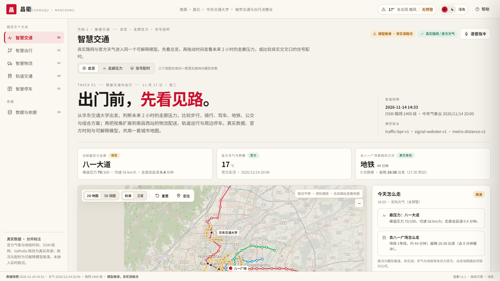

# 昌衢 Changqu · 城市交通与出行决策台

> **Trae on Campus @ 华东交通大学 · 2026 年 11 月 14 日**
> 团队：**Token猛猛蹬**（使用 Trae 制作）

昌衢是一套面向南昌的城市交通与出行决策台。它把真实路网、中央气象台天气快照、南昌地铁时刻与可解释模型放进同一张地图，帮助用户在出门前判断路况、比较出行方式、规划配送与停车。

**在线体验**：https://37ka76y57k0fmd1s7nx.traesite.cn



---

## 一、这个作品是做什么的

城市出行信息往往分散在多个 App：路况在一个地方、地铁时刻在另一个地方、停车与配送又要重新查。昌衢把这些信息合并到一套界面里：

- **同一张地图**：2D 与 3D 共享同一套数据、筛选项与路线；
- **可解释模型**：路况压力、信号配时、物流路线、客流排队都给出公式、参数与限制；
- **数据可追溯**：每条结论都标注来源、时间、字段与未接入项；
- **离线优先**：核心页面读取本地真实数据快照，断网也能演示。

面向人群：南昌市民与通勤者、高校师生、交通管理/研究者、物流调度人员，以及活动评审与观众。

---

## 二、功能总览

### 1. 智慧交通

- **总览**：实时压力分布、天气与地铁信息、行程建议、走廊压力排行与压力等级构成图。
- **走廊压力**：拖动时间滑杆查看未来 0–120 分钟的压力变化；点击路段查看 BPR 公式、参数与情景区间。
- **信号配时**：选择真实交叉口，对比固定配时与 Webster 优化后的延误、排队长度与绿灯时间分配。
- 地图支持悬停高亮、点击反馈，颜色随场景与时刻平滑过渡。

### 2. 智慧出行

- 任意起点与终点，支持 111 座地铁站与常用地点。
- **9 种出行方式同台比较**：步行、骑行、驾车、地铁、公交、公交 + 地铁、骑行 + 公交、骑行 + 地铁、驾车 + 地铁。
- **语音助手**：用一句话描述出行需求，自动提取起点、终点、时间与偏好并应用（示例句可直接点击）。
- 截止时间与偏好设置，路线按真实路网与站序计算。
- **2D / 3D 行程动画**：按真实路径播放，可跟随、可拖动进度，视图切换不中断动画。

### 3. 智慧物流

- 选择起点与多个真实目的地，设置车辆与任务参数。
- 基于 OSM 路网的 A* 路径、节约算法 + 2-opt 排车，与「按单直送」基线对照。
- 图表展示总里程、车辆数、装载率、车队构成、单车里程与任务分配。
- 车辆沿真实路网行驶动画，2D / 3D 同步。
- 所有结果均可追溯到输入与算法参数。

### 4. 轨道交通

- **首末班与班次**：依据南昌轨道交通官方线网图与 1/2/3 号线首末时刻表，推算下一班与后续计划班次（计划推算，不是实时位置）。
- **客流推演**：一分钟步长排队模型，对比加通道、限流前后的排队与疏散情况。
- **安全科普**：依据乘客守则整理的 8 张知识卡片，只做科普，不做题。

### 5. 智慧停车

- 507 个真实 OSM 停车场，可按距离、容量等条件筛选。
- 选中停车场后沿真实路网生成驾车引导，2D / 3D 均可查看。
- 明确标注：容量为停车场规模，不是实时空余车位；预约仅是本机意向，不构成真实锁位。

### 6. 数据与依据

- 把数据分为**真实、模型、用户输入、未接入**四类，分开展示。
- 每条数据标注来源、时间、字段、覆盖范围与限制。
- 支持刷新真实天气等数据（需本地 Python 服务与网络）。

### 7. 全局交互

- 六个栏目：智慧交通、智慧出行、智慧物流、轨道交通、智慧停车、数据与依据。
- 浅色 / 深色主题一键切换，深色下 3D 城市保持深色底图。
- 2D 与 3D 地图随时切换；3D 城市可按住拖动旋转，查看跨江桥、快速路与整片城区。
- 3D 城市含 18,000 栋建筑体量、31,420 条道路、水面与桥隧、树木与车流示意。
- 图表支持悬停查看数值；关键参数变化带动地图与图表动画。
- 内置帮助中心，解释每个功能、用法与名词。

---

## 三、启动方法

### 环境要求

- Windows 10 / 11
- Python 3.9 或更高版本（**只用标准库，不需要安装任何第三方 Python 包**）
- 浏览器建议 Edge 或 Chrome

### 方式一：双击启动（推荐）

1. 打开 `app` 文件夹；
2. 双击 `start.bat`；
3. 脚本会自动选择空闲端口、启动本地服务并打开浏览器；
4. 关闭弹出的命令行窗口即可停止服务。

### 方式二：命令行启动

在项目根目录打开 PowerShell 或命令提示符：

```bash
python app\start.py
```

看到类似 `昌衢 Changqu 启动：http://127.0.0.1:8765/` 的提示后，在浏览器打开该地址。

> 若 8765 被占用，程序会自动尝试 8765–8785 中的空闲端口。
> 不要直接用 `file://` 打开 `app/index.html`，否则本地数据与瓦片会被浏览器拦截。

### 常见问题

| 问题 | 处理方式 |
| --- | --- |
| 双击没反应或提示未检测到 Python | 安装 Python 3.9+，安装时勾选 Add Python to PATH |
| 端口被占用 | 关闭其他本地服务，或让程序自动选择 8765–8785 |
| 页面打开但地图空白 | 确认 `app/tiles` 与 `app/data` 完整，且通过本地服务访问 |
| 语音识别不可用 | 浏览器需支持语音识别并允许麦克风；不上传到本项目服务器 |
| 断网能否使用 | 能。核心数据为本地快照；刷新真实数据与在线路径在断网时会失败并保留旧数据 |

---

## 四、使用教程

### 首页 / 智慧交通

1. 打开后默认进入「智慧交通 · 总览」，可看到当前压力地图、天气、地铁与行程建议。
2. 拖动时间滑杆，观察未来两小时路况颜色与走廊压力变化。
3. 点击地图上的红色路段，右侧会显示该路段的压力公式、参数和情景区间。
4. 切换到「走廊压力」「信号配时」查看排行、构成图与 Webster 对照。
5. 右上角拨片切换浅色 / 深色主题；地图工具栏切换 2D / 3D。

### 智慧出行

1. 选择起点与终点（也可以直接在地图上点选）。
2. 设置截止时间与偏好，点击「生成方案」。
3. 在右侧比较 9 种方式的耗时、换乘、费用与可靠性，点击某种方式查看分段路线。
4. 点击播放按钮查看 2D / 3D 行程动画；可跟随车辆或拖动进度。
5. 在语音助手中输入「明天下午五点半，从华东交通大学到八一广场，少走路」，点击应用即可自动填充条件。

### 智慧物流

1. 选择起点（仓库）与多个目的地。
2. 设置车辆数与任务参数，点击生成配送方案。
3. 查看节约算法 + 2-opt 的排车结果，并与按单直送基线对照。
4. 查看里程、装载率、车队构成图表；播放车辆沿路网行驶动画。

### 轨道交通

1. 选择线路、站点与方向，查看下一班与后续计划班次。
2. 在「客流推演」中调整到达人数、开放通道数或限流比例，对比排队变化。
3. 在「安全科普」中浏览 8 张乘客守则知识卡片。

### 智慧停车

1. 按区域、距离或容量筛选停车场。
2. 点击停车场查看容量、类型与位置。
3. 点击「驾车引导」，沿真实路网生成路线，可切换 2D / 3D 查看。
4. 注意：容量不是实时余位，预约只保存在本机。

### 数据与依据

1. 查看每类数据的来源、时间、字段与限制。
2. 需要更新天气等真实数据时，在本地服务运行状态下点击刷新。

---

## 五、数据与边界

- **地图与城市数据**：© OpenStreetMap contributors（ODbL 1.0），本地快照生成于 2026-11-14；含 18,000 栋建筑体量、31,420 条道路、507 个停车场、1,557 个地点。
- **天气**：中央气象台 2026-11-14 14:00 快照，用于演示，不代表实时天气。
- **地铁**：南昌轨道交通官方线网图与 1/2/3 号线首末时刻表（2026-11-14 核对）；4 号线站序来自官方线网图。班次为**计划推算**，不是列车实时位置。
- **模型**：BPR 路阻、Webster 信号配时、节约算法 + 2-opt、一分钟步长排队模型；参数与公式在界面中公开。
- **边界**：3D 建筑高度仅少量为标注值，其余按类型示意；停车场容量不是实时余位；预约不构成真实锁位；本作品用于学习、展示与决策辅助，不用于实际调度指挥。

---

## 六、目录结构

```text
.
├─ README.md
├─ preview.png
├─ .gitignore
└─ app/
   ├─ index.html          # 单页应用入口
   ├─ css/
   │  └─ app.css          # 设计系统与全部页面样式
   ├─ js/                 # 原生 ES Modules（页面、模型、地图、图表、语音）
   ├─ data/               # 本地真实数据快照与数据说明
   ├─ tiles/              # 离线地图瓦片（OSM）
   ├─ vendor/             # Leaflet 与 Three.js 本地依赖
   ├─ start.bat           # Windows 双击启动
   ├─ start.py            # 启动脚本（自动选端口、打开浏览器）
   └─ server.py           # Python 标准库本地服务（静态托管 / 数据刷新 / 路径代理）
```

---

## 七、技术栈

- 原生 HTML / CSS / JavaScript（ES Modules），无前端框架、无构建步骤。
- Leaflet 2D 地图 + Three.js 3D 城市，共享数据与交互状态。
- Canvas / SVG 绘制柱状图、环形图、堆叠图与动画。
- Python 标准库 HTTP 服务：静态文件、`/api/refresh` 数据刷新、`/api/route` 在线路径代理。
- 离线瓦片与本地数据快照，保证断网可演示。

---

## 八、说明与致谢

- 本项目为 **Trae on Campus @ 华东交通大学**（2026 年 11 月 14 日）活动作品，由团队 **Token猛猛蹬** 使用 Trae 制作，代码以 MIT License 开源，欢迎学习、交流与二次开发；转载或使用请保留项目来源与数据署名（详见 LICENSE）。
- 地图数据 © OpenStreetMap contributors，遵循 ODbL 1.0；瓦片来自 OSM France；2D 地图使用 Leaflet，3D 使用 Three.js，均已保留本地依赖与署名。
- 线上版本为静态托管，页面与离线数据完整可用；「刷新真实数据 / 在线路径」依赖本地 Python 服务。
- 感谢 Trae on Campus @ 华东交通大学 活动与 Trae 提供的支持。
